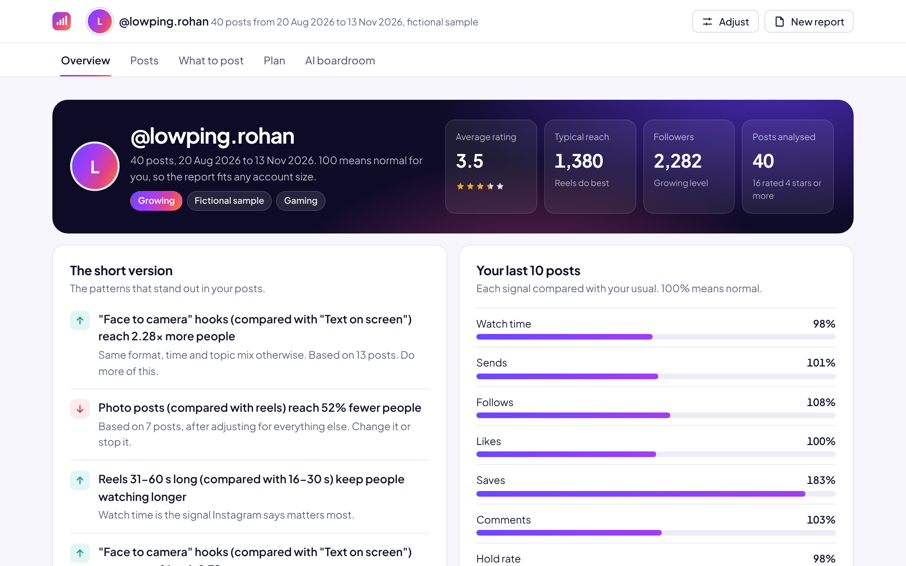
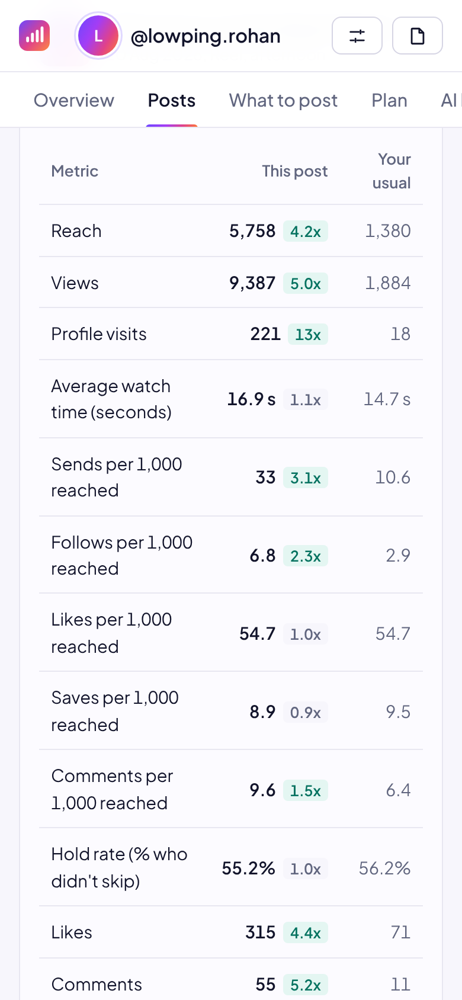
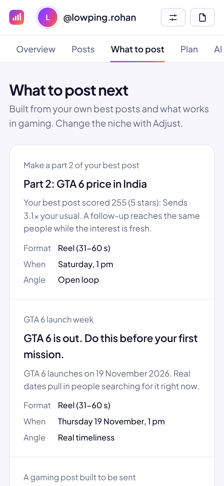
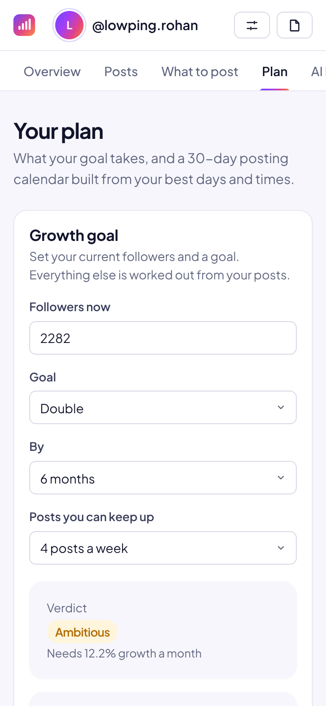

<div align="center">

# Creator Growth Studio

**Know which posts grow your account, and why.**<br>
A free report for Instagram, YouTube and Twitch: a star rating for every post, the reason it worked or flopped, what to post next, and a 30-day plan.

[](https://siddharthmehdiratta.github.io/creator-growth-studio/)
[](LICENSE)
[](https://siddharthmehdiratta.github.io/creator-growth-studio/features/)
[](https://github.com/Siddharthmehdiratta/creator-growth-studio/stargazers)

### [Get your free report](https://siddharthmehdiratta.github.io/creator-growth-studio/start.html) · [See a sample](https://siddharthmehdiratta.github.io/creator-growth-studio/start.html?sample=1) · [Beginner's guide](https://siddharthmehdiratta.github.io/creator-growth-studio/guide/)



</div>

## Why it exists
Most growth advice is generic. Your numbers aren't. This tool compares every post with **your own** typical post, like with like, so the advice fits an account of 80 followers or 80,000. No password, no sign-up, and the report is worked out in your browser.

## What you get
| | |
|---|---|
| **Every post, rated** | 1 to 5 stars from watch time, sends, follows, likes, saves and comments, against your own usual. |
| **Why it worked** | Each number next to your usual, with a plain reason and what to do next time. |
| **What to post next** | Ideas built from your own best posts, with the format, day and time that work for you. |
| **A 30-day plan** | Is your follower goal realistic? A calendar of your best days that drops into Google Calendar. |
| **Comments sorted** | Questions, requests, praise, criticism and spam, in English and Hinglish. |
| **AI boardroom** | A CEO, growth lead, social media expert, SEO lead, data analyst and creative director review you in Claude. |
| **Audience health check** | What a brand sees before paying: engagement against accounts of the same size. |

<p align="center">&nbsp;&nbsp;&nbsp;&nbsp;</p>

## Quick start
1. Open **[the live site](https://siddharthmehdiratta.github.io/creator-growth-studio/)** and press **Get my free report**.
2. Pick **Instagram**, **YouTube** or **Twitch**.
3. Bring your numbers: type a username, upload your platform's export, or type in your streams.

Nothing to install. The sample account in the screenshots is **fictional**.

## Built to be honest
- Official data only: Instagram's official API, or exports you download yourself. **No scraping, no bots, no passwords.**
- Patterns compare like with like, and every finding says how strong the evidence is.
- Platform rules are dated and sourced in the [Growth guide 2026](https://siddharthmehdiratta.github.io/creator-growth-studio/growth-guide/).

## The full way: Claude Code skills
Install in Claude Code: paste `https://github.com/Siddharthmehdiratta/creator-growth-studio` and say "install this skill pack". Then type:

| Command | What it does |
|---|---|
| `/growth-studio` | The whole studio, start to finish |
| `/growth-audit` | Post-by-post audit from your export |
| `/growth-plan` | Growth map, 30-day calendar and a calendar file |
| `/growth-boardroom` | Advisers plus an AI audience panel (one sub-agent per viewer) |
| `/growth-write` | Hooks, scripts, captions, titles and bios, in English, Hinglish or Hindi |
| `/growth-seo` | Be found on Instagram search, Google and YouTube |
| `/growth-money` | Monetization readiness, a rate card from your own reach, and a brand pitch |
| `/brand-scout` | Vet influencers before paying them |

## For developers
| Folder | What it is |
|---|---|
| `site/` | The website: Next.js + Tailwind, based on the free [Velora UI](https://github.com/ColorlibHQ/velora-ui) template (MIT). |
| `site/public/` | The report app itself (`start.html`, `app.js`, `engine.js`), plain HTML and JavaScript. |
| `docs/` | The built site that GitHub Pages serves. Rebuild with `sh tools/build_site.sh`. |
| `connect/` | The Instagram connector, a free Cloudflare Worker. See [CONNECT-INSTAGRAM.md](CONNECT-INSTAGRAM.md). |
| `skills/` | Claude Code skills and the Python engine. |

The engine is `skills/growth-audit/growth.py`: standard-library Python 3.8+. The website runs the same maths in `site/public/engine.js`, and a test checks both give identical numbers.

## Tests
```
python3 -m unittest discover -s tests
node tests/js/parity.js     # browser engine = Python engine
node tests/js/worker.mjs    # Instagram connector, with a fake Instagram
# serve docs/ at http://localhost:8765/creator-growth-studio/ then:
python3 tests/e2e/report_flow.py    # every page and the report, in Chrome, desktop and phone
python3 tests/e2e/connect_flow.py   # username lookup and Connect, with a fake connector
```
The sample account in `site/public/data/` is **fictional**. It was generated with known patterns, and the tests check that the audit finds them.

## Contributing
Questions go in [Discussions](https://github.com/Siddharthmehdiratta/creator-growth-studio/discussions), problems in [Issues](https://github.com/Siddharthmehdiratta/creator-growth-studio/issues). Pull requests are welcome; tests run on every change.

Made by Siddharth Mehdiratta. MIT licence. Sister project: [Founder Plus](https://github.com/Siddharthmehdiratta/founder-skill-plus), which tests a business idea on AI customers.
